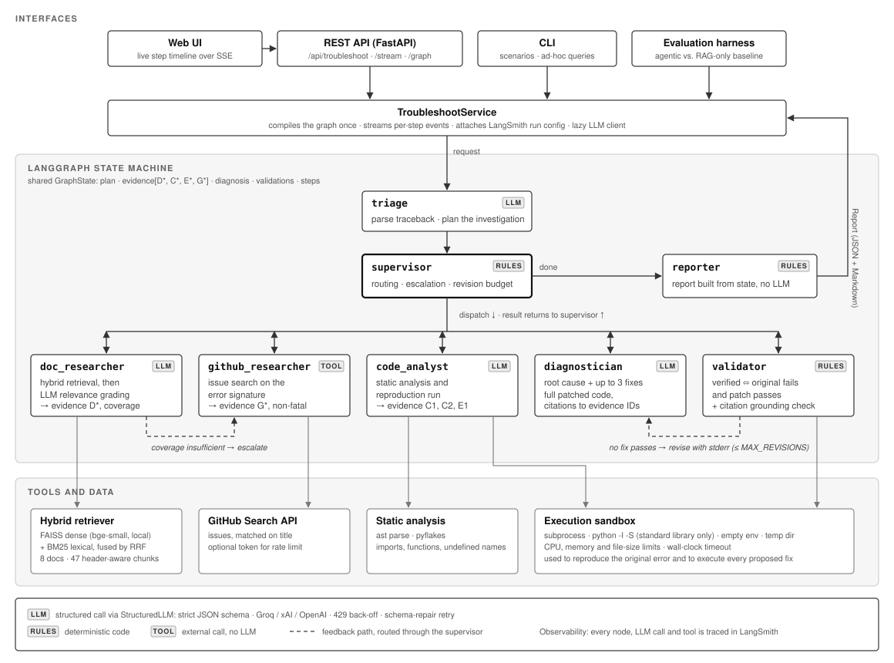

# Agentic Troubleshooter

**A multi-agent assistant that investigates Python errors, grounds its diagnosis in retrieved documentation, and verifies proposed fixes by executing them.**

Given a traceback, a code snippet, or a debugging question, a team of specialised agents coordinated by a LangGraph supervisor plans an investigation, retrieves and grades documentation with hybrid search, reproduces the failure in a sandbox, proposes fixes with citations to the collected evidence, and executes those fixes to check whether they work. The output is a structured report where every fix carries an explicit validation status. Fixes that could not be verified are labelled as such and never presented as tested.

<p align="center"><em>Stack:</em> LangGraph · LangChain · FAISS · BM25 · FastEmbed · Groq / xAI / OpenAI · LangSmith · FastAPI · Docker</p>

---

## Contents

1. [Motivation](#1-motivation)
2. [System overview](#2-system-overview)
3. [Agents](#3-agents)
4. [Design decisions](#4-design-decisions)
5. [Knowledge base and scenarios](#5-knowledge-base-and-scenarios)
6. [Evaluation methodology](#6-evaluation-methodology)
7. [Observability](#7-observability)
8. [Getting started](#8-getting-started)
9. [Project structure](#9-project-structure)
10. [Limitations and future work](#10-limitations-and-future-work)
11. [References](#11-references)

---

## 1. Motivation

Debugging means moving back and forth between error logs, source code, documentation and issue trackers. A conventional chatbot collapses that process into a single generation step. It pattern-matches on the error message and produces a plausible answer, but it neither checks that the explanation fits the code nor tests the fix.

This project treats debugging as an investigation with explicit steps:

| Question a developer asks | Component that answers it |
|---|---|
| What kind of problem is this and where should I look? | Triage agent |
| What does the documentation say about this failure? | Documentation researcher (hybrid RAG + relevance grading) |
| Does the code actually fail the way the report says? | Code analyst (static analysis + sandboxed reproduction) |
| Has someone hit this in a library before? | GitHub researcher |
| What is the root cause and what are the fixes? | Diagnostician |
| Do the fixes work? | Validator (execution + citation checks) |

The objective is a report a developer can trust because it shows its evidence and is explicit about what was and was not verified.

## 2. System overview

<p align="center">
  
</p>

The graph uses a **hub-and-spoke** topology. Every worker returns control to the supervisor, which is the only node that chooses what runs next. A typical request flows as follows:

1. **Triage** parses the traceback with a regex-based parser (frames, exception type, chained exceptions, warnings) and asks the LLM for an investigation plan. The plan contains search queries, a problem category, and whether code analysis or GitHub search is worthwhile.
2. The **supervisor** dispatches the planned specialists. If the documentation researcher reports *insufficient* coverage, the supervisor adds a GitHub search that was not originally planned.
3. The **diagnostician** receives all evidence, each item tagged with an ID (`D1`, `C2`, `E1`, `G1`, …), and returns a root cause, a confidence level and up to three fixes. Every fix includes complete patched code and citations.
4. The **validator** executes each fix and checks its citations. If no fix passes and at least one fails, the supervisor sends the diagnostician back for one revision, passing along the sandbox stderr.
5. The **reporter** assembles the final report from state, without an LLM call.

A run with code makes four LLM calls (triage, document grading, code analysis, diagnosis), plus one per revision.

## 3. Agents

| Node | Kind | Inputs → outputs | Implementation |
|---|---|---|---|
| `triage` | LLM + parser | report → `ParsedTraceback`, `TriagePlan`, plan of specialists | [`agents/triage.py`](troubleshooter/agents/triage.py) |
| `supervisor` | Deterministic | state → `next_step` | [`agents/supervisor.py`](troubleshooter/agents/supervisor.py) |
| `doc_researcher` | Retrieval + LLM grader | queries → graded `Evidence[D*]`, coverage | [`agents/researchers.py`](troubleshooter/agents/researchers.py) |
| `code_analyst` | Tools + LLM | code → static report, sandbox run, `CodeFindings`; `Evidence[C*, E1]` | [`agents/code_analyst.py`](troubleshooter/agents/code_analyst.py) |
| `github_researcher` | External tool | error signature → `Evidence[G*]` | [`agents/researchers.py`](troubleshooter/agents/researchers.py) |
| `diagnostician` | LLM | evidence (+ feedback) → `Diagnosis` | [`agents/diagnostician.py`](troubleshooter/agents/diagnostician.py) |
| `validator` | Sandbox + rules | fixes → `FixValidation` per fix, feedback | [`agents/validator.py`](troubleshooter/agents/validator.py) |
| `reporter` | Deterministic | state → `Report` (JSON + Markdown) | [`agents/reporter.py`](troubleshooter/agents/reporter.py) |

All LLM outputs are Pydantic models enforced through strict JSON-schema structured outputs ([`schemas.py`](troubleshooter/schemas.py)).

## 4. Design decisions

### 4.1 A deterministic supervisor and an LLM planner

LangGraph supervisors are often implemented as an LLM that picks the next node. This system splits the responsibility instead:

- **The LLM decides what is worth investigating.** The triage plan chooses the queries and specialists, and the diagnosis supplies the answer.
- **Code decides control flow.** The supervisor handles ordering, escalation, the revision budget and termination.

As a result, every run is bounded. The worst case is the planned specialists, one GitHub escalation and `MAX_REVISIONS + 1` diagnoses. Every routing decision is explainable from state alone, because it is logged with a reason and visible in the UI timeline. The routing logic can also be unit-tested without a model. The cost is that the supervisor cannot invent new strategies. For a domain with a small, well-understood set of investigation steps, predictability is worth more.

### 4.2 Hybrid retrieval with reciprocal rank fusion

Error messages contain exact tokens such as `NoneType`, `JSONDecodeError` and `__init__`, which dense embeddings tend to blur together. Developer questions, by contrast, are often paraphrases ("why does my list keep growing"). The retriever ([`rag/retriever.py`](troubleshooter/rag/retriever.py)) runs FAISS dense search and BM25 [5] over the same chunks for every query and fuses the rankings with **reciprocal rank fusion** (RRF, *k* = 60) [1]. RRF uses ranks, not scores, so there is no need to calibrate cosine similarity against BM25 scores. The BM25 tokenizer keeps identifiers intact, so `NoneType` stays one token.

Documents are chunked on **Markdown headers first** and by size second. Every chunk is therefore a coherent section with a citable title such as *"None Values and In-Place Methods > Symptom: 'NoneType' object is not subscriptable"*.

### 4.3 Corrective retrieval and coverage-driven escalation

Retrieved chunks are graded by the LLM for relevance to the specific problem before they reach the diagnosis. This is a simplified form of corrective RAG [2]. The grader also reports coverage (`sufficient`, `partial` or `insufficient`), and the supervisor acts on it: insufficient coverage triggers a GitHub issue search even if triage did not plan one. Retrieval quality therefore changes the plan instead of failing silently.

### 4.4 Reproduce before diagnosing

When code is supplied, the code analyst runs it in the sandbox before any fix is proposed. The run serves three purposes:

1. It confirms that the reported error is real and occurs where the report says (`reproduced: yes/no` in the report).
2. Its stderr becomes evidence (`E1`) that the diagnosis can cite.
3. It is the baseline for validating fixes.

### 4.5 Execution-based validation with a discriminating criterion

A fix is labelled **verified** only if the **original fails and the patched code passes**. Running the patch alone is not enough, because code that runs cleanly may never have exercised the bug. The rules ([`agents/validator.py`](troubleshooter/agents/validator.py)):

| Situation | Status |
|---|---|
| Original fails, patch runs cleanly (or passes its assertions) | `verified` |
| Patch raises or times out | `failed` |
| Patch fails only for environmental reasons (`ModuleNotFoundError`, network, files) | `not_verifiable` |
| Original only failed for environmental reasons | `not_verifiable` |
| Original and patch both run cleanly | `not_verifiable` |
| No code change proposed, or execution disabled | `not_run` |

For bugs that do not raise, such as mutable default arguments, the diagnostician may attach `test_code`: assertions that are appended to both the original and the patched code. This turns a behavioural bug into one that execution can verify, and it works only if the assertions actually tell the two versions apart.

### 4.6 Bounded self-correction

If no fix passes and at least one fails, the validator's stderr is fed back to the diagnostician for a revision, similar to Self-Refine [3] and Reflexion [4]. The feedback is concrete, for example *"AttributeError: 'list' object has no attribute 'sorted'"*, rather than a self-critique. The loop is capped by `MAX_REVISIONS` (default 1) so cost and latency stay predictable.

### 4.7 Evidence IDs and citation grounding

Every piece of evidence gets a stable ID, and the diagnostician must cite IDs in its reasoning and fixes. The validator checks each fix's citations against the evidence actually collected. Citations to IDs that do not exist are flagged in the report as warnings. This catches a common hallucination pattern cheaply and deterministically.

### 4.8 A deterministic reporter

The final report is assembled from state rather than written by an LLM. Validation labels, warnings ("Fix 2 is unverified: …") and the reproduction result cannot be softened or paraphrased away by a final summarisation step.

### 4.9 Provider abstraction and testability

Agents depend on a one-method `StructuredLLM` protocol ([`llm.py`](troubleshooter/llm.py)), not on a provider SDK. The production implementation uses LangChain's OpenAI-compatible chat client with strict structured outputs, so the provider is a configuration value selected with `LLM_PROVIDER`: Groq (default, `openai/gpt-oss-20b`), xAI or OpenAI. Two provider realities are handled in [`llm.py`](troubleshooter/llm.py). Tokens-per-minute 429s are retried after the provider's suggested delay, while out-of-credit errors fail immediately. Providers that validate structured output after generation (Groq returns `json_validate_failed`) are re-prompted with the validation error, up to two times. The test suite uses a scripted model keyed by output schema. As a result, the full graph, including the revision loop, the revision budget, citation checks and GitHub escalation, is tested end-to-end without network access or API cost. The LLM client is created lazily, so the UI, retrieval and sandbox work before a key is configured.

### 4.10 Local embeddings

Embeddings use `BAAI/bge-small-en-v1.5` [6] through FastEmbed (ONNX, CPU). Indexing therefore needs no API key, costs nothing, and gives the same vectors on every run. In the Docker image, the model and FAISS index are built at image build time, so containers start offline.

### 4.11 Sandbox

Snippets run in a subprocess with `python -I -S`, which isolates them from environment variables, user site-packages and installed packages, leaving the **standard library only**. They also get an empty environment, a temporary working directory, CPU/memory/file-size limits and a wall-clock timeout ([`tools/sandbox.py`](troubleshooter/tools/sandbox.py)). Restricting snippets to the standard library makes runs reproducible, and it is why third-party fixes are reported as `not_verifiable` rather than verified. The sandbox does **not** block network access. Run the service in Docker as a non-root user (as the provided image does) before exposing it to others.

## 5. Knowledge base and scenarios

The documentation corpus ([`data/docs/`](data/docs)) contains eight focused Markdown documents on Python failure modes, written from and linking to the official Python documentation:

| Document | Covers |
|---|---|
| `none_and_in_place_methods.md` | `list.sort()` returning `None`, implicit `None` returns |
| `dict_iteration_mutation.md` | `RuntimeError: dictionary changed size during iteration` |
| `scoping_unboundlocalerror.md` | LEGB, `global` / `nonlocal`, `UnboundLocalError` |
| `json_decoding_errors.md` | `JSONDecodeError` messages and causes |
| `asyncio_coroutines.md` | Missing `await`, `asyncio.run`, blocking calls |
| `imports_and_environments.md` | Interpreter mismatch, shadowing, circular imports |
| `mutable_default_arguments.md` | Shared default values |
| `builtin_exceptions_reference.md` | Reading tracebacks; common built-in exceptions |

The corpus is chunked into 47 sections. To extend it, add Markdown files with `Source: <url>` lines and run `make index`.

[`data/scenarios.json`](data/scenarios.json) holds seven scenarios. The UI uses them as one-click examples and the evaluation uses them as test cases. They were chosen to exercise different paths through the graph:

| Scenario | Exercises |
|---|---|
| `none-sort`, `dict-mutation`, `unbound-local`, `json-empty` | Reproduction and execution-verified fixes |
| `coroutine-not-awaited` | Exception plus `RuntimeWarning` parsing |
| `module-not-found` | Environmental issue; correct outcome is *not verifiable* |
| `mutable-default` | No exception; verification requires generated assertions |

## 6. Evaluation methodology

[`eval/run_eval.py`](eval/run_eval.py) compares the agentic workflow with a **RAG-only baseline** ([`baseline.py`](troubleshooter/baseline.py)): one hybrid retrieval over the raw report and one diagnosis call, with the same model and the same diagnosis prompt. The baseline has no triage, grading, code analysis, reproduction or revision. Both systems' fixes are checked by the **same validator**, so the comparison isolates the workflow from the checking.

| Metric | Definition |
|---|---|
| `root_cause_hit` | Every keyword group in the case's `expected.root_cause_keywords` appears in the root cause or reasoning (each group is an any-of list) |
| `error_type_correct` | Agentic only: the classified exception type matches |
| `verification_ok` | A fix was verified **if and only if** the case is expected to be verifiable. A "verified" environment fix counts as an error |
| `grounded_fixes` | Share of fixes whose citations are non-empty and all exist |
| `llm_calls`, `latency_s` | Cost and speed |

```bash
make eval                                   # all scenarios, both systems
python -m eval.run_eval --cases none-sort mutable-default
```

Results are printed as a table and saved to `eval/results/` (not committed).

**Observed run** (Groq, `openai/gpt-oss-20b`, reasoning effort `low`, 7 cases, one run):

| Metric | Agentic | RAG-only baseline |
|---|---|---|
| `root_cause_hit` | 1.00 | 1.00 |
| `error_type_correct` | 1.00 | n/a |
| `verification_ok` | 1.00 | 1.00 |
| `grounded_fixes` | 1.00 | 1.00 |
| LLM calls per case | 4 | 1 |

On this set, both systems identify every root cause, and every expected-verifiable case gets a sandbox-verified fix. **The current cases do not separate the two approaches.** They are well-known standard-library failure modes that a single grounded LLM call resolves. The agentic workflow's added value here is reproduction evidence, error classification, and validation and citation checks attached to the report, not higher accuracy. Wall-clock latencies from this run are omitted because they were dominated by free-tier rate-limit waits (an unthrottled single investigation completes in about 2–3 s on Groq).

A set that can separate the systems needs cases where investigation changes the answer: misleading tracebacks, errors that only reproduce under execution, and multi-cause failures. With seven cases and keyword-based scoring, treat these numbers as a regression check, not a benchmark.

## 7. Observability

With `LANGSMITH_TRACING=true` and `LANGSMITH_API_KEY` set, each investigation is one LangSmith trace containing every graph node, LLM call and tool call. The same steps are shown live in the UI timeline.

## 8. Getting started

Requires Python 3.11+ and an API key for Groq (default, free tier), xAI or OpenAI.

```bash
make setup     # create .venv, install dependencies, copy .env.example to .env
               # then set GROQ_API_KEY in .env
make run       # http://localhost:8000
make test      # 26 tests, no API key needed
make eval      # agentic vs. RAG-only baseline
```

To use a different provider, set `LLM_PROVIDER` and the matching key; [`.env.example`](.env.example) lists all settings. For Docker, run `docker compose up --build`.

**Other interfaces.** CLI: `python -m troubleshooter.cli --scenario none-sort`. REST: `POST /api/troubleshoot`, or `/api/troubleshoot/stream` for server-sent events. Interactive docs are at `/docs`, and [`examples/request.json`](examples/request.json) is a sample request.

## 9. Project structure

```
troubleshooter/
├── agents/
│   ├── triage.py          # traceback parsing + investigation plan
│   ├── supervisor.py      # deterministic routing, escalation, revision budget
│   ├── researchers.py     # documentation (hybrid RAG + grading) and GitHub
│   ├── code_analyst.py    # static analysis + sandboxed reproduction
│   ├── diagnostician.py   # root cause and fixes with citations
│   ├── validator.py       # execution-based validation + grounding check
│   ├── reporter.py        # deterministic report assembly
│   └── common.py
├── rag/
│   ├── indexer.py         # header-aware chunking, FAISS index build
│   └── retriever.py       # dense + BM25 with reciprocal rank fusion
├── tools/
│   ├── sandbox.py         # isolated subprocess execution
│   ├── static_analysis.py # ast + pyflakes
│   ├── traceback_parser.py
│   └── github_search.py
├── web/                   # single-page UI (no build step)
├── graph.py               # LangGraph wiring
├── state.py               # graph state and node names
├── schemas.py             # Pydantic contracts and LLM output schemas
├── llm.py                 # StructuredLLM protocol + OpenAI-compatible client (Groq, xAI, OpenAI)
├── service.py             # run / stream orchestration
├── baseline.py            # RAG-only baseline
├── api.py                 # FastAPI app
└── cli.py
data/docs/                 # knowledge base
docs/architecture.svg      # architecture diagram
examples/request.json      # sample API request
data/scenarios.json        # demo and evaluation cases
eval/run_eval.py           # agentic vs. baseline comparison
tests/
```

## 10. Limitations and future work

- **Scope.** The knowledge base covers a focused set of Python failure modes. Questions outside it rely on the model's own knowledge and the GitHub search, and the report flags low documentation coverage.
- **Verification is only as strong as execution.** A fix is checked against the submitted snippet in a standard-library sandbox. It is not checked against the developer's full application, dependencies or data. Fixes involving third-party packages are reported as `not_verifiable`.
- **Sandbox isolation is best effort.** Process limits and an isolated interpreter are not a security boundary. A production deployment should use a container or microVM per execution (for example gVisor or Firecracker) with networking disabled.
- **Evaluation size.** Seven cases with keyword-based scoring are enough for regression testing, not for statistical claims. Natural next steps are a larger case set drawn from real tracebacks (for example Stack Overflow questions with accepted answers) and an LLM-as-judge rubric for root-cause quality.
- **Future work:** dependency-aware sandboxes, so third-party fixes can be verified; per-repository indexes, by ingesting a project's own docs and issues; and persisting runs with a LangGraph checkpointer for multi-turn follow-up questions.

## 11. References

1. G. V. Cormack, C. L. A. Clarke, and S. Büttcher. *Reciprocal Rank Fusion outperforms Condorcet and Individual Rank Learning Methods.* SIGIR, 2009.
2. S.-Q. Yan, J.-C. Gu, Y. Zhu, and Z.-H. Ling. *Corrective Retrieval Augmented Generation.* arXiv:2401.15884, 2024.
3. A. Madaan et al. *Self-Refine: Iterative Refinement with Self-Feedback.* NeurIPS, 2023.
4. N. Shinn et al. *Reflexion: Language Agents with Verbal Reinforcement Learning.* NeurIPS, 2023.
5. S. Robertson and H. Zaragoza. *The Probabilistic Relevance Framework: BM25 and Beyond.* Foundations and Trends in Information Retrieval, 2009.
6. S. Xiao et al. *C-Pack: Packaged Resources To Advance General Chinese Embedding* (BGE embeddings). arXiv:2309.07597, 2023.
7. LangGraph documentation, https://langchain-ai.github.io/langgraph/
